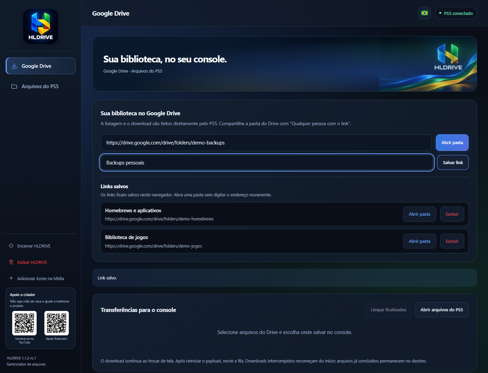

# HLDRIVE

Gerenciador de arquivos homebrew para PS5, com navegação em pastas públicas do Google Drive e download direto para o console. Interface, imagens e recursos estão incorporados em um único arquivo `HLDRIVE.elf`.

> **Pré-release 1.1.2-rc.1 — links salvos e avisos do Drive traduzidos.** Salve suas pastas favoritas com um nome opcional, abra novamente pela lista e exclua links que não usa mais. Avisos do Google Drive acompanham o idioma selecionado. Mantém o fundo animado e o download experimental da versão anterior; desempenho ainda não confirmado no PS5. [Baixar ELF](https://github.com/louro2023/HLDRIVE/releases/download/v1.1.2-rc.1/HLDRIVE.1.1.2-rc.1.elf) · [SHA-256](https://github.com/louro2023/HLDRIVE/releases/download/v1.1.2-rc.1/HLDRIVE.1.1.2-rc.1.elf.sha256) · [Notas e limitações](docs/releases/v1.1.2-rc.1.md).

**Downloads:** [ELF 1.0.2](https://github.com/louro2023/HLDRIVE/releases/download/v1.0.2/HLDRIVE.elf) · [SHA-256](https://github.com/louro2023/HLDRIVE/releases/download/v1.0.2/HLDRIVE.elf.sha256) · [Release](https://github.com/louro2023/HLDRIVE/releases/tag/v1.0.2)

Veja a [galeria de telas](docs/GALLERY.md), [histórico de alterações](CHANGELOG.md) e [instruções de compilação](docs/BUILD.md).

**Miniatura no Payload Manager:** adicione a [fonte HLDRIVE](https://raw.githubusercontent.com/louro2023/HLDRIVE/main/repository/payloads.json) em **Settings → Manage Sources → Add Source**. Depois procure HLDRIVE em **Get Payloads**. [Instruções e funcionamento do ícone](repository/README.md).

## Funcionalidades

- Selecionar Português (Brasil), English (US) ou Español (Argentina) pelo botão de bandeira no topo da interface.

- Abrir links públicos do Drive e navegar por subpastas.
- Salvar links de pastas com um nome opcional, reabrir pela lista e excluir links salvos. A lista fica armazenada no navegador utilizado; limpar os dados do site remove os links.
- Selecionar arquivos e pastas e escolher o destino no PS5.
- Acelerar arquivos grandes com até 16 conexões simultâneas por arquivo, segmentos de 8 MiB e gravações agrupadas quando o Drive oferecer intervalos e um identificador forte; os arquivos escolhidos são baixados em fila. O painel mostra velocidade em Mbps/MiB/s, média, conexões ativas e motivo de usar conexão única.
- Baixar itens selecionados ou copiar e colar arquivos no console.
- Preservar pastas, acompanhar progresso e cancelar transferências.
- Navegar, copiar, mover, renomear e excluir arquivos locais.
- Abrir a interface no navegador e registrar um atalho na aba Mídia.
- Encerrar ou remover os arquivos e configurações próprios do HLDRIVE.
- Exibir QR codes discretos para inscrição no [canal do criador](https://www.youtube.com/@henriquelouro7848) e apoio financeiro.

O console acessa o Drive e realiza os downloads. É necessária uma pasta compartilhada como “Qualquer pessoa com o link”; não há login Google/OAuth.

## Links salvos

Cole o endereço público da pasta, informe um nome opcional e clique em **Salvar link**. Na lista **Links salvos**, use **Abrir pasta** para acessar novamente ou **Excluir** para remover somente o favorito. Excluir um link não remove arquivos do Drive nem downloads do console.

Os links ficam neste navegador e endereço de acesso. Outro dispositivo, navegador ou endereço/IP terá sua própria lista; limpar os dados do site remove os favoritos. A lista impede duplicar a mesma pasta mesmo quando o link usa parâmetros de compartilhamento diferentes.

## Idioma da interface

Clique na **bandeira no canto superior direito** e selecione Português (Brasil), English (US) ou Español (Argentina). O seletor reaproveita o estilo do Prospero Manager e usa bandeiras SVG incorporadas ao ELF, sem depender de emojis ou imagens externas.

A mudança é imediata e preserva a seleção de arquivos. A preferência fica salva no navegador/dispositivo usado para acessar o HLDRIVE; outro navegador pode ter uma escolha diferente. O padrão é Português (Brasil).

Menus, tela do Drive, transferências, gerenciador de arquivos e diálogos acompanham o idioma. Avisos conhecidos do Google Drive, como cota de downloads, permissão e arquivo indisponível, também acompanham a seleção, inclusive em transferências que já falharam. Avisos não reconhecidos do Google recebem uma mensagem genérica traduzida; o texto original permanece no log. Nomes de arquivos, caminhos e mensagens técnicas retornadas pelo backend são preservados; alguns diagnósticos podem continuar em português. [Veja as telas simuladas](docs/GALLERY.md).

## Requisitos e primeiro uso

- PS5 com ambiente homebrew ativo e um método compatível para iniciar arquivos ELF.
- Internet e espaço disponível no destino.

1. Baixe o arquivo `.elf` nos anexos da release e inicie-o pelo ambiente homebrew configurado no console. Nesta pré-release ele se chama `HLDRIVE.1.1.2-rc.1.elf`.
2. O payload tenta abrir `http://127.0.0.1:8081/?console=1`. Se necessário, acesse `http://IP_DO_PS5:8081` na rede local.
3. Na aba Google Drive, informe o link público da pasta. O PS5 busca e baixa os arquivos por conta própria.

O atalho na aba Mídia abre a interface enquanto o processo estiver ativo; ele não inicia o ELF após reiniciar o console. Veja [compatibilidade](docs/COMPATIBILITY.md) e [validação](docs/TESTING.md).

## Downloads e exclusão

Os downloads são gravados no destino escolhido. Interrupções abruptas podem deixar arquivos temporários `.part`. A fila de transferências não é retomada após reiniciar o processo.

**Excluir HLDRIVE** remove o atalho, a cópia `HLDRIVE.elf` da pasta configurada e `/data/HLDRIVE`. Arquivos armazenados fora da pasta própria do HLDRIVE não são removidos.

## Limitações e segurança

- O acesso ao Drive depende da disponibilidade do HTML público do Google e de `/system/common/cert/CA_LIST.cer`; a validação de certificados TLS permanece habilitada.
- Pastas muito grandes, documentos nativos, atalhos, cotas ou exigência de login podem limitar downloads.
- A interface local não possui autenticação. Use em rede confiável e não exponha a porta 8081 à internet.
- Compatibilidade varia por firmware e ambiente homebrew. O teste relatado pelo usuário confirma o desempenho em seu console, mas não certifica outras configurações ou velocidades.

## Licença

Código sob [GNU GPL v3](LICENSE). Componentes incluídos mantêm seus avisos e condições próprios; veja [avisos de terceiros](THIRD_PARTY_NOTICES.md). O código-fonte acompanha a distribuição do ELF.
