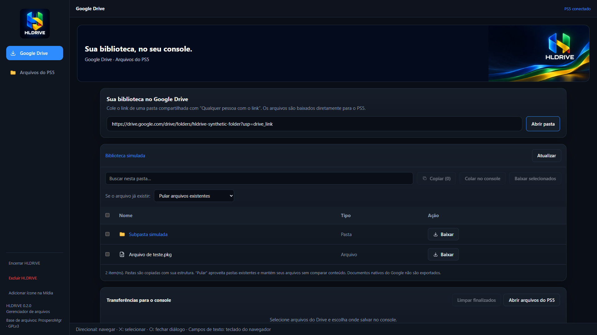
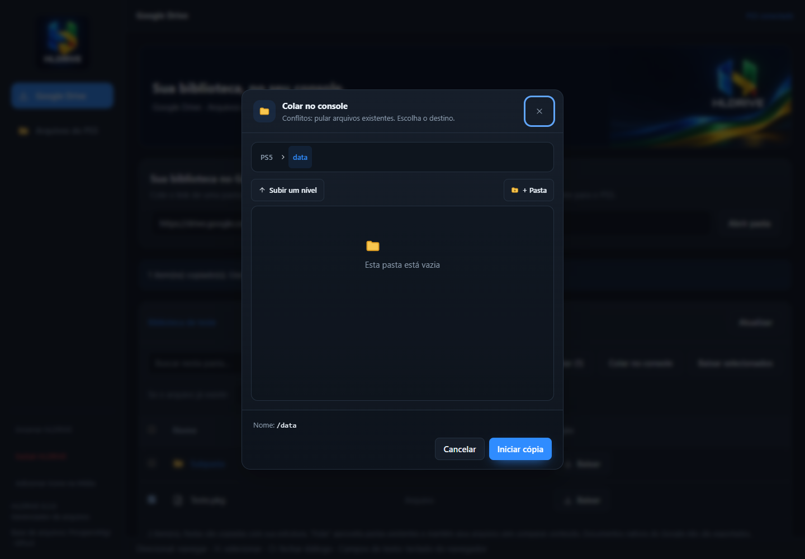
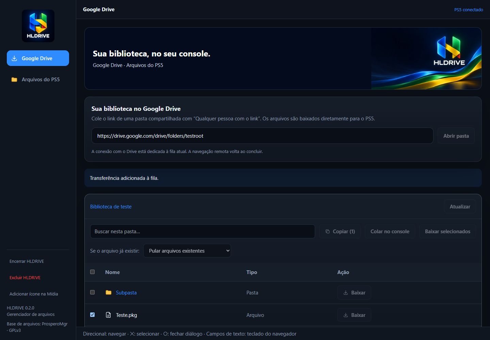
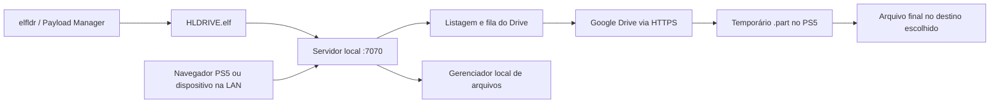

# HLDRIVE

**Gerenciador homebrew de arquivos para PS5 com navegação em pastas públicas do Google Drive e download direto para uma pasta escolhida no console.**

O HLDRIVE combina uma interface baseada no [ProsperoMgr](https://github.com/notmaj0r/ProsperoMgr) com um backend nativo em C++ e uma integração própria com o Google Drive. Interface, imagens e recursos ficam incorporados em um único `HLDRIVE.elf`.

> **v0.2.1 — versão experimental.** O acesso ao Google Drive foi migrado para libcurl/OpenSSL no PS5, com validação de certificados usando a lista de CAs do sistema e resolução DNS pelo serviço de rede do console. A compilação passou; listagem e downloads reais ainda precisam ser validados em um PS5. Não desative a validação TLS.

**[Baixar HLDRIVE.elf](https://github.com/louro2023/HLDRIVE/releases/download/v0.2.1/HLDRIVE.elf)** · **[Release](https://github.com/louro2023/HLDRIVE/releases/tag/v0.2.1)** · **[SHA-256](https://github.com/louro2023/HLDRIVE/releases/download/v0.2.1/HLDRIVE.elf.sha256)** · **[Atualizações](CHANGELOG.md)**

*Captura do navegador em modo console, com APIs simuladas. “PS5 conectado” e os arquivos exibidos são dados de teste, não evidência de execução no hardware.*

## Funcionalidades

Veja a **[galeria de telas simuladas com a identidade HLDRIVE](docs/GALLERY.md)**: escolha do destino, transferência, arquivos locais, confirmação de exclusão e encerramento. A logo e o banner estão incorporados ao ELF v0.2.1.

- Abrir links de pastas públicas do Drive e navegar por subpastas.
- Selecionar arquivos/pastas e escolher o destino no PS5.
- Usar **Baixar selecionados** ou **Copiar → Colar no console**.
- Preservar a estrutura de diretórios ao baixar uma pasta.
- Acompanhar progresso, velocidade média, estimativa de tempo e arquivos concluídos/ignorados.
- Cancelar transferências e limpar tarefas finalizadas.
- Navegar pelos arquivos locais, copiar, mover, renomear, excluir e usar os recursos de arquivos compactados herdados do Prospero.
- Solicitar abertura da interface no navegador do PS5 e registrar um atalho próprio na aba **Mídia**.
- Encerrar o processo ou remover atalho/configurações com confirmações separadas.

**Abrir a pasta não inicia downloads.** Não há sincronização automática de toda a biblioteca nem instalação automática de jogos/pacotes. O HLDRIVE não fornece conteúdo, contas ou bibliotecas de jogos.

## Requisitos e compatibilidade

- PS5 com ambiente homebrew já ativo, privilégios compatíveis e loader ELF, como **elfldr**.
- Internet para acessar o Drive e espaço suficiente no destino.
- Pasta compartilhada como **“Qualquer pessoa com o link”**. Não há login Google/OAuth.

O alvo inicial de testes é **firmware 12.40 com elfldr**. **É possível que o HLDRIVE também rode no firmware 13.60, porém ainda não foi testado nessa versão.** O SDK v0.44 utilizado contém suporte ao 13.60, e os projetos de referência oferecem caminhos de carregamento para esse firmware. Essa evidência não confirma o funcionamento do HLDRIVE, dos downloads ou do controle no console; não há uma faixa de firmwares homologada.

| Ambiente | Situação |
| --- | --- |
| elfldr | ELF64 x86-64 e envio pela porta usual 9021; execução real ainda requer teste. |
| Payload Manager | Fluxo de importação/envio ao elfldr compatível por análise do código. HLDRIVE não está no catálogo padrão. |
| Relapse | Usa elfldr em 9021 e declara suporte ao 12.40 e 13.60; isso não certifica HLDRIVE. Seu menu padrão não inclui HLDRIVE. |
| Outros loaders | Não homologados nesta versão. |

[Detalhes de compatibilidade](docs/COMPATIBILITY.md). O HLDRIVE não executa um exploit nem acrescenta suporte de jailbreak a um firmware.

## Instalação e primeiro uso

1. Baixe **somente `HLDRIVE.elf`** na [release v0.2.1](https://github.com/louro2023/HLDRIVE/releases/tag/v0.2.1). Não precisa copiar a pasta `build`, imagens ou código-fonte.
2. Inicie o ambiente homebrew e o elfldr no PS5.
3. Envie o ELF pelo loader, normalmente na porta **9021**, ou importe e execute pelo Payload Manager.
4. O payload tenta abrir `http://127.0.0.1:7070/?console=1` no navegador do console. Se não abrir, acesse **`http://IP_DO_PS5:7070`** de outro dispositivo na mesma rede.
5. Na aba **Google Drive**, cole o link público e pressione **Abrir pasta**. A conexão e a transferência são feitas pelo próprio PS5.

O atalho na aba Mídia abre a interface enquanto o payload está rodando. **Ele não carrega o ELF após reiniciar ou encerrar.** Execute novamente pelo loader ou configure o autoload no Payload Manager.

Encerre uma versão anterior antes de carregar a nova. Outra aplicação usando a porta 7070 também impede o servidor de iniciar.

## Escolher onde salvar

1. Marque os arquivos/pastas desejados.
2. Use **Baixar selecionados**, ou **Copiar** e depois **Colar no console**.
3. Escolha o diretório de destino e confirme em **Iniciar cópia**.

Por exemplo, `arquivo.pkg` baixado para `/data/Jogos` fica em `/data/Jogos/arquivo.pkg`. Uma pasta selecionada mantém suas subpastas dentro do destino. O seletor permite `/data` e áreas externas aceitas; o backend verifica o diretório antes de gravar.

Durante o download, o conteúdo vai para um temporário `.part`, renomeado ao concluir. Falhas/cancelamentos tratados removem o parcial. Uma interrupção abrupta pode deixar um `.part` órfão.

| Conflito de nome | Comportamento |
| --- | --- |
| Pular arquivos existentes | Preserva arquivos sem comparar conteúdo/tamanho; percorre pastas existentes para baixar o que falta. |
| Manter ambos com outro nome | Gera um nome alternativo para o novo item. |
| Parar este item | Interrompe o item em conflito e apresenta o erro. |

A fila fica em memória e precisa ser recriada após reiniciar o payload. Não há retomada de um download remoto parcial.

## Interface e controle

O menu oferece **Google Drive** e **Arquivos do PS5**. No modo `?console=1`, o foco é destacado e as setas navegam entre controles. Quando o navegador expõe um gamepad padrão, direcional navega, **✕** seleciona e **○** fecha diálogos.

Botões físicos, entrada de texto e histórico dependem do navegador PS5. Foram simulados em testes, mas ainda não homologados no console.

As artes HLDRIVE aparecem no ícone de mídia, favicon, menu lateral, banner e tela de encerramento. O banner é um fundo **do HLDRIVE**, não papel de parede do sistema PS5. [Mapa das artes](assets/branding/README.md).

## Encerrar, excluir e atualizar

| Ação | Efeito |
| --- | --- |
| Encerrar HLDRIVE | Pede confirmação e encerra somente o processo; mantém arquivos, configurações e atalho. |
| Excluir HLDRIVE | Pede confirmacao, remove o atalho, a copia `HLDRIVE.elf` da pasta de payloads configurada e toda a pasta `/data/HLDRIVE`, depois encerra. Downloads guardados em `/data/HLDRIVE` tambem sao apagados. |
| Adicionar ícone na Mídia | Repete o registro e apresenta erros do serviço de instalação. |

As ações recusam prosseguir durante transferências, uploads ou operações locais ativas. Conclua ou cancele a fila antes de tentar novamente.

“Excluir” remove recursivamente `/data/HLDRIVE` e a copia `HLDRIVE.elf` da pasta de payloads configurada. Downloads fora de `/data/HLDRIVE`, outros payloads e configuracoes do manager em pastas compartilhadas permanecem.

Para atualizar: encerre a versão antiga, substitua/importe o ELF da nova release e execute novamente. Não há atualização automática própria nesta versão.

## Como funciona

O payload PS5 consulta `embeddedfolderview` por HTTPS e exibe a lista do Drive. O próprio console baixa os arquivos para o destino escolhido. O DNS configurado no console permanece inalterado.

Veja [arquitetura](docs/ARCHITECTURE.md), [compilação](docs/BUILD.md) e [testes](docs/TESTING.md).

## Limitações e diagnóstico

- O payload usa libcurl/OpenSSL no PS5, valida certificados com `/system/common/cert/CA_LIST.cer` e deixa a resolução DNS a cargo do serviço de rede do console, respeitando o DNS definido nas configurações de rede do PS5.

- A navegação e o download exigem que `/system/common/cert/CA_LIST.cer` exista e contenha uma CA válida para o Google.

- O HTML do Google não é uma API estável. Não há paginação própria nem garantia de listar integralmente bibliotecas muito grandes.
- Até **32 itens ativos** na fila; tarefas de pasta limitadas a **32 níveis e 10.000 itens**. Transferências sequenciais; navegação remota bloqueada enquanto há fila ativa.
- Documentos nativos do Google e atalhos não são exportados. Cotas, bloqueios e exigência de login podem impedir downloads.
- O atalho pode falhar quando `/user/app` não existe ou a exportação individual do serviço está indisponível. Isso não impede o servidor de iniciar.
- As APIs locais não possuem autenticação nem validação de origem equivalente à do Payload Manager recente. Use em rede local confiável e não exponha a porta 7070 à internet.
- Enviar o ELF ao loader não comprova inicialização, HTTPS, armazenamento ou comportamento após standby.

Ao abrir uma [issue](https://github.com/louro2023/HLDRIVE/issues), informe versão, firmware, loader, ação realizada e mensagem completa. Remova links privados, tokens e dados pessoais dos logs.

## Licença e créditos

Código sob [GNU GPL v3](LICENSE). Componentes de terceiros mantêm suas licenças, incluindo condições próprias do UnRAR: [avisos de terceiros](THIRD_PARTY_NOTICES.md). O código-fonte acompanha a distribuição do ELF.

- [ProsperoMgr](https://github.com/notmaj0r/ProsperoMgr), de maj0r: base da interface e gerenciador de arquivos, commit `9dd11c5efc7f36bb85b3319348434e071ac99b21`.
- [PS5 Payload SDK](https://github.com/ps5-payload-dev/sdk): toolchain, runtime e exemplo de abertura do navegador.
- [ps5-browser-app](https://github.com/kvnhrt/ps5-browser-app): referência de registro individual do atalho.
- [gdown](https://github.com/wkentaro/gdown): referência pública do fluxo de confirmação; a integração C++ do HLDRIVE é própria.
- [Payload Manager](https://github.com/itsPLK/ps5-payload-manager) e [Relapse](https://github.com/soniciso1/relapse): referências do fluxo de carregamento.
- Overdrive foi referência documental; seu navegador/código não está incorporado.

Projeto independente, sem afiliação com Sony/PlayStation ou Google. Artes geradas para o HLDRIVE; originais em `assets/branding`.
