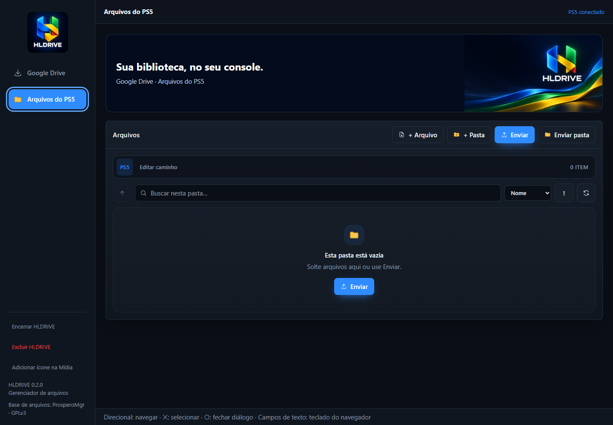
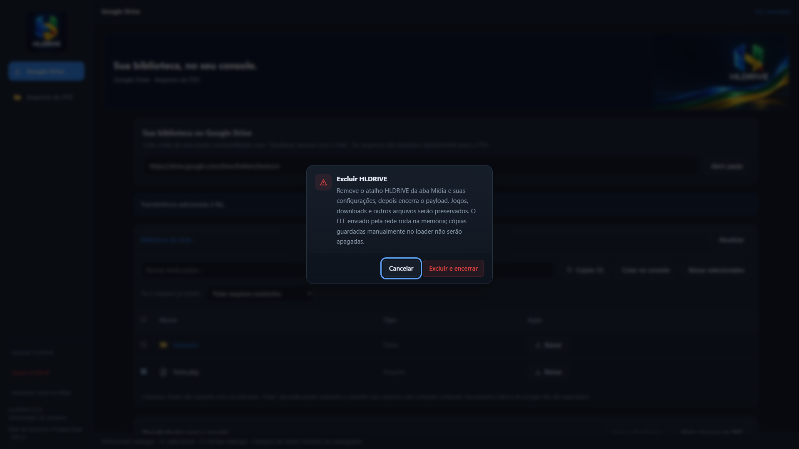
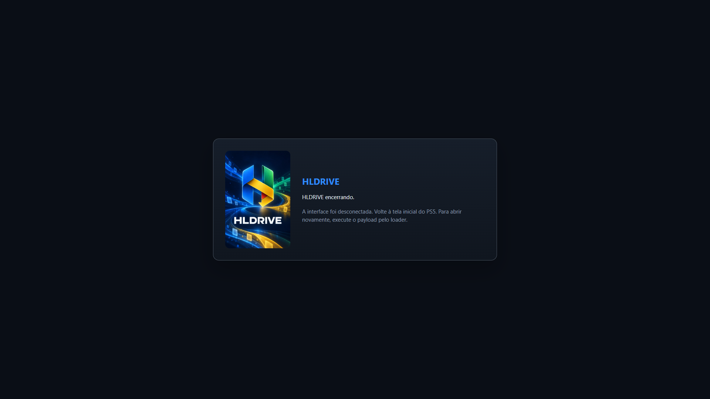
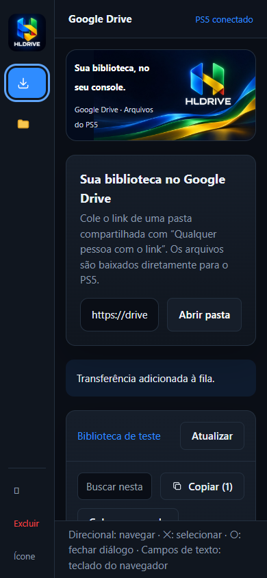

# Galeria da interface HLDRIVE

Capturas da interface real do projeto executada no Chrome, com APIs, arquivos, conexão e controle simulados. Não são capturas do PS5 e não comprovam downloads no console. Nenhum arquivo do Google Drive foi baixado para gerar estas imagens.

A logo criada para HLDRIVE aparece no menu lateral; a arte hero identifica o banner. A capa aparece ao encerrar. Esses recursos fazem parte do ELF 1.0.1, sem necessidade de arquivos de imagem separados. Veja o [mapa das artes](../assets/branding/README.md).

## Pasta pública do Drive

## Escolha da pasta de destino

O diálogo permite escolher onde salvar antes de iniciar a cópia. O diretório `/data` exibido aqui é simulado.

## Transferência em andamento

Progresso e dados de arquivo fictícios para demonstrar a interface.

## Arquivos do PS5

## Confirmação de exclusão

## Encerramento

## Acesso em tela pequena

## Reproduzir as capturas

Após compilar o frontend, sirva `source/frontend/dist` em `127.0.0.1:4173` e execute `node tools/ui-test/smoke.cjs`. A listagem principal é gerada por `node tools/ui-test/drive-connect.cjs`, que inicia seu próprio servidor. As imagens resultantes ficam em `build`. Consulte [TESTING.md](TESTING.md).
